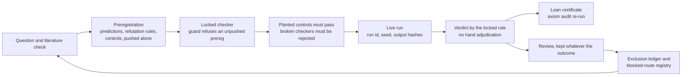

# PositiveGeometryEmergentSpaceTime

**A positive-geometry structure, checked in Lean, aimed at deriving the Standard Model with zero fitted parameters. Ongoing research.**

The bar is deliberately hard. A result counts only if a *dimensionless* Standard-Model quantity (a mass ratio, a coupling ratio, a charge, `N_c`, `N_gen`, chirality) comes out of a positive-geometry object with zero fitted parameters, a Lean definition and a preregistered test. Every closed route is kept, because each one narrows the map.

## Claim tags

Every claim in this folder and in the accompanying papers carries one tag.

| Tag | Meaning |
|---|---|
| `PROVED` | Checked by the Lean kernel: the axiom audit shows only `propext`, `Classical.choice` and `Quot.sound`, and no `sorry`. |
| `SIMULATED (run id)` | Computed by a locked checker; the run id points to its manifest, seed and output hashes. |
| `CITED` | Taken from a published source that was fetched and read. |
| `CONJECTURE` | Stated precisely and supported by evidence, but not proved. |
| `SPECULATION` | An idea or direction, with no evidence claimed. |

A proof written out on paper but not in Lean is marked "paper-proved" and is not `PROVED`.

## Status

Lean totals are from the axiom audit re-run on this export. The other meters are as recorded on 2026-10-31 in the trade-space notes.

| Meter | Now | Next rungs |
|---|---|---|
| Lean library | 1378 theorems, 798 definitions, 0 non-standard axioms, 0 `sorry`-dependent, over 140 modules `PROVED` | Formalise the general capped-Forman bound and the general associahedron per-edge formula |
| Derivation meter (R4-DM v3) | 1/87 Standard-Model ledger items; the one item (`EWZ1b.forced`) is conditional and amplitude-sourced `SIMULATED` | CASCADE-2 (preregistered, not run) |
| Quantum-number meter | 0/73 | Proposed basins B6, B9, B10 |
| Preregistrations | 112 files in `prereg/`, each pushed before its run | One per new rung |
| Result reviews | 114 rung reviews (in `reviews/`, alongside convention checks and tag changes), by heuristic verdict class: 39 PASS, 18 MIXED, 16 ILL-DEFINED, 14 PARTIAL or CONDITIONAL, 13 FAIL or REFUTED, 10 NO-GO, 2 NOT-EVALUATED, 1 NUMEROLOGY, 1 EMPTY | Every new rung adds one |
| Blocked-route registry | 77 tagged routes, 35 of them NO-GO, each with a reopen trigger | Reopen when a trigger fires |
| Exclusion ledger | 35 Lean-anchored no-go rows, 30 proposed | |
| Bibliography | 119 entries, 115 verified against the fetched source | |

The derivation and quantum-number meters measure the open target. They are low because the bar is a zero-parameter derivation, and the trade space is still being mapped.

## Established and open

**Established**
- Lean library: 1378 theorems and 798 definitions with 0 non-standard axioms and 0 `sorry`-dependent declarations `PROVED`.
- MR-1b: blind Lovelace–Shapiro coupling ratios `5/16` (ρ₃) and `49/240` (f₄) `PROVED` agree with both width sources for both states, inside the preregistered bands `SIMULATED`.
- SURF-1′: no `N ≥ 3` makes the one-loop colour factors sign-coherent `PROVED`, and the result survives the convention re-check `SIMULATED (SURF1-2026-10-28-r1)`.
- CASCADE-1b r2: locked PASS at the blind `n = 6` `SIMULATED (CASCADE1b-2026-10-24-r2)`, with the held-out family proved in Lean `PROVED`.
- Curvature: exact Ollivier–Ricci curvature of the associahedron flip graph, and the capped-Forman equality on all 140,107 edges of 513 simple polytopes `SIMULATED (CAPPEDF1-20261031T120726Z)`.
- 35 Lean-anchored no-go rows, each closing one Standard-Model line for one route.

**Open**
- A zero-parameter Standard-Model quantity from a positive geometry (meter 1/87, quantum numbers 0/73).
- The two cross-basin hubs described in the evidence paper are conjectures about the record itself `CONJECTURE`.
- CASCADE-1: whether its locked FAIL is void on audit. The FAIL stays on the record.
- The capped-Forman equality in general `CONJECTURE`: no proof in any dimension, including 3.
- The literature sweep is at abstract level; a full-text pass would sharpen the novelty statements.

## Highlights

**Lean library and axiom audit.** `AxiomsAll.lean` lists every theorem and definition in `PositiveGeometryEmergentSpaceTime.*` with the axioms it depends on. The current audit reads `theorems=1378 defs=798 nonstandard=0`, with 0 axiom declarations, 0 opaque declarations and 0 `sorry`-dependent declarations. Toolchain `leanprover/lean4:v4.34.1`; Mathlib `d13f23b723b8`; Physlib `a4ef46125b32`.

**MR-1b, a blind match.** The Lovelace–Shapiro amplitude has one input, the ρ mass. Before any ρ₃(1690) or f₄(2050) coupling data was opened, the residues gave `g²(ρ₃ππ)/g²(ρππ) = 5/16` and `g²(f₄ππ)/g²(ρππ) = 49/240` `PROVED` (`LSResidue.rho3_ratio`, `LSResidue.f4_ratio`). All four comparisons (two states, two sources each) pass, with `z` from −0.57 to +1.16 `SIMULATED`. This is a check of a known amplitude on blind data, not a derivation from geometry.

**SURF-1′, a colour-sign no-go.** Surface-type colour sums do not select `N_c` by a sign condition. For `N ≥ 3` either the triangle-type or the crossed-box coefficient is negative: `K_tri(3) = −1` and `K_box×(N) = −8(N²−10)/(N(N²−4)) < 0` for `N ≥ 4` `PROVED`. The `U(N)` null is sign-coherent for every `N = 3,…,30`, so the emptiness comes from the `SU(N)` trace term `SIMULATED`.

**CASCADE-1b r2, a locked PASS.** All 11 planted cases pass and `n = 4, 5` reproduce exactly. At the blind `n = 6`, the near-zero factorisation tests pass 90/90 and the factorisation tests 36/36, while the off-family control passes 0/30, so the test discriminates `SIMULATED`. The held-out family follows from stage 3 by a translation of the mass offsets `PROVED` (`Cascade1bR2.c_transport`). The PASS confirms the corrected code path; on physics, the ratio sub-verdict at `n = 6` is RATIOS-FREE (one linear mass relation, no ratio fixed).

**Curvature of polytope graphs.**
- *Associahedron (HG-DIM-1).* On the flip graph of `K_n`, the edge that flips a diagonal inside a quadrilateral `Q` has Ollivier curvature `κ = (2 − p)/(n − 2)`, where `p` is the number of sides of `Q` that are diagonals. This holds on every one of 26,175 edges for `n = 6,…,11` `SIMULATED (HGDIM1-LIVE-20261031T090819)` and is paper-proved for all `n`. The mean curvature is `(10 − n)/((n − 2)(2n − 5))`, which vanishes exactly at the decagon: paper-proved for all `n`, with the general algebra and the instances `n = 5,…,9` `PROVED`. Lean checks the per-edge formula on named `K_7` edges only.
- *Capped-Forman (CAPPED-FORMAN-1).* For every simple polytope, `κ(e) ≥ 1 − Σ_F min(3, k_F − 3)/(D + 1)` over the 2-faces `F` through `e`. This inequality is a special case of Jost and Münch, Cor. 6.2 ([arXiv:2110.04554](https://arxiv.org/abs/2110.04554)) `CITED`. Equality holds on all 140,107 edges of 513 simple polytopes in dimensions 2 to 8, including 18,388 edges with faces of 7 to 12 sides and 21,775 edges on non-facial short cycles; maximum gap 0 `SIMULATED (CAPPEDF1-20261031T120726Z)`. Equality in general is open `CONJECTURE`. Lean proves the per-face optimisation and "capped ≥ Forman, with equality iff every face has at most 6 sides" `PROVED`.
- *Permutohedron (HG-DIM-2).* `κ = (2 − 2h)/n` with Forman curvature `2 − 2h`, where `h` is the number of hexagons through the edge, on all 158,322 edges for `n = 3,…,8` `SIMULATED (HGDIM2-20261031T104614)`. The formula is known: Cushing et al. ([arXiv:2310.15953](https://arxiv.org/abs/2310.15953)) `CITED`. Lean checks `n = 4, 5, 6` `PROVED`.

## Statement alignment (2026-11-03)

A Lean theorem only supports a paper claim if it states what the prose says. This layer checks that link. It lives in `lean/PositiveGeometryEmergentSpaceTime/Alignment/` (75 modules), is not imported by `PositiveGeometryEmergentSpaceTime`, and leaves the main totals at 1378/798/0/0. Its axiom audits (`lean/Alignment*Axioms*`, with their `_output.txt` files) show only `propext`, `Classical.choice` and `Quot.sound`, with no `sorry`. No credit changed.

- **Blueprint.** Each sentence in the papers that cites Lean is paired with the declaration it cites. All 409 cited declarations exist and are axiom-clean. Of the 125 rows judged, 108 are MATCH, 8 NAME-ONLY and 9 OVERSTATES. All 17 non-MATCH rows were corrected in the papers by narrowing or scoping the wording, never by upgrading it, and each corrected row now reads MATCH. Of the 34 glossary terms checked, the 4 that differed from the Lean object and the 12 that were missing from the papers are now defined in the papers. See [`ROLLOUT-BLUEPRINT`](notes/alignment/ROLLOUT-BLUEPRINT-2026-11-03.md) and [`RESOLVED`](notes/alignment/RESOLVED-2026-11-03.md).
- **Sanity theorems.** For definitions that were right only by name, a check proves known values, rejects a planted wrong case and shows the hypotheses can be met. Where possible, it also ties the definition to the object the paper names. Phase B added 85 theorems in 9 modules and Phase C added 884 theorems in 23 modules, all `PROVED`:
  - JORD-1: the full Jordan identity on ℚ²⁷ holds, and dim Der = 52 (`Jord1Der.finrank_der`). Der ≅ f₄ stays `CITED`.
  - SURF-1′: the K₃,₃ coefficient table is checked by the kernel, so the Lean no-go is now unconditional.
  - H-T5: the GP sign rule holds at n = 3 by exhaustion.
  - EW-Z1b: the Feynman-rule tie is still open. An independent derivation agrees on 200 of 200 points `SIMULATED (EWZ1B-INDEP-2026-11-03-r1)`.

  See [`SANITY`](notes/alignment/SANITY-2026-11-03.md) and [`SANITY-b`](notes/alignment/SANITY-2026-11-03b.md).
- **Blind second formalisations.** A rung is restated in Lean from the prose alone. The prose-only version is pushed before the original is opened, and then the two are compared (EQUIV, ORIG-/BLIND-STRONGER, DIFFERENT).
  - BLIND-2 (10 rungs): 3 EQUIV, 1 BLIND-STRONGER, 1 EQUIV on numbers but ORIG-STRONGER on rigour, and 5 DIFFERENT from a convention, input or generality choice, with the overlap `PROVED`.
  - BLIND-3 (MR-4, MR-2, KL-LAT/KS-1): it found that the cited KL-LAT theorems assume the ½ intercepts. The derivation is now `PROVED` (`Compare.KLLAT`), and no number moved ([`TAG-CHANGE-2026-11-03b`](reviews/TAG-CHANGE-2026-11-03b.md)).
  - BLIND-4: MR-1f, below.

  No blind version contradicts its original. See [`BLIND`](notes/alignment/BLIND-2026-11-03.md).
- **LEAN-CERT-2.** The Lean status changed from PARTIAL-LIMIT to `PROVED` for all 8 counts: k = 2, 3 now give 5 / 0 / 10 / 2 in `LeanCert2K23`. The sampled checks stay `SIMULATED`. See [`TAG-CHANGE-2026-11-03`](reviews/TAG-CHANGE-2026-11-03.md).
- **MR-1f width formula.** Before BLIND-4, only `poch3` had Lean behind it. Now the Gamma ratio for all J, the residue (equal to the script's up to one uniform sign), the Legendre projections for J = 1–4 and the kinematics are `PROVED`. The ratios also have proved intervals: R2 ∈ (0.89485, 0.89495), R3 ∈ (0.57755, 0.57765) and R4 ∈ (0.36485, 0.36495), each `PROVED`. These bracket both the script and the blind run `SIMULATED (BLIND4-PY-2026-11-03-r1)`. The data comparison stays `SIMULATED`, and the pole factor and width convention stay `CITED`. See [`BLIND-4-RESULT`](notes/alignment/BLIND-4-RESULT-2026-11-03.md).

## Method

Each test is a *rung*. A rung moves through the same gates every time:



- **Preregistration.** Predictions, probabilities, refutation rules and controls are written and pushed alone before any code runs. Locked files are never edited; a correction supersedes them in a new file.
- **Locked checkers.** The checker's hash is pinned in the preregistration, and a guard refuses to run against an uncommitted preregistration.
- **Planted and broken controls.** Planted cases with known answers must pass; deliberately broken checkers must be rejected.
- **Kept negative results.** FAIL, NOT-EVALUATED and wrong predictions stay on the record, with their reopen triggers.
- **Exclusion ledger.** Each closed route is a Lean-anchored row naming the Standard-Model line it closes and for which route.

## Evidence index

Hashes are source commits; [`PROVENANCE.tsv`](PROVENANCE.tsv) maps each exported file to its source commit. Lean modules are under `PositiveGeometryEmergentSpaceTime.`.

| Rung | Prereg | Run id | Lean module | Review | Verdict |
|---|---|---|---|---|---|
| MR-1b | `cdef00b` | none (exact computation) | `LSResidue` | `15653cb` | PASS, blind, 2 sources per state |
| R4-DM v3 | `d9b60aa` | none (declaration scan) | (scans the whole library) | `4d390a2` | meter 1/87; quantum numbers 0/73 |
| EW-Z1b | none | none | `EWZ1b` | `b779ab1` | conditional, amplitude-sourced match |
| CASCADE-1 | `af1bb37` | `CASCADE1-2026-10-23-r1` | `Cascade1` | `9ed0afd` | locked FAIL (kept); hypothesis REFUTED-AS-STATED |
| CASCADE-1b r2 | `9b1dca2` (rules: `27a47fd`) | `CASCADE1b-2026-10-24-r2` | `Cascade1bR2` | `4bf8205` | PASS; RATIOS-FREE |
| SURF-1′ | `ce4a4ee` | `SURF1-2026-10-28-r1` | `Surf1.Main`, `SurfConv` | `cb064b7` | EMPTY, so NO-GO (convention-robust) |
| HG-DIM-1 | `bbfe77b` | `HGDIM1-LIVE-20261031T090819` | `HgDim1`, `HgDim1Mean`, `HgDim1Mean9` | `0026ed3` | LOCAL-COUNT |
| HG-DIM-2 | `5935f37` | `HGDIM2-20261031T104614` | `HgDim2`, `HgDim2P4`, `HgDim2P5`, `HgDim2P6` | `23332ce` | LINK-HOLDS (formula known) |
| CAPPED-FORMAN-1 | `27395b7` | `CAPPEDF1-20261031T120726Z` | `CappedForman`, `CappedFormanCerts` | `c20bb74` | INEQ-HOLDS + EQ-HOLDS |
| YM-IMPORT | not yet | not run | none | planning note | planned; waits on a public Lean artifact |

The evidence paper's reproducibility table lists the same pointers for every rung it discusses.

## Layout

```
PositiveGeometryEmergentSpaceTime/
  README.md              this file
  lean/                  Lake package PositiveGeometryEmergentSpaceTime (own lakefile, toolchain, manifest),
                         AxiomsAll.lean and its output, axiom gate files, the alignment layer and its audits
  prereg/                preregistrations
  reviews/               result reviews, convention checks, tag changes
  runs/                  run manifests (seeds, hashes)
  sims/                  locked checkers, planted cases, small outputs
  predictions/           locked prediction files and their hashes
  scripts/               analysis scripts referenced by reviews
  tools/alignment/       prose-to-Lean alignment tooling and outputs
  notes/                 blocked-route registry, trade-space notes, exclusion ledger, Lean glossary and maps
  reproduce.sh           rebuilds the Lean library and re-runs the axiom audits
  requirements-lock.txt  pinned Python environment
  CITATION.cff
  PROVENANCE.tsv         exported file -> source commit, SHA-256 of the source file, SHA-256 of the exported file
```

Files were exported from a private working repository at one commit, without its history.

### Hashes and redacted copies

Some files were changed on export: paths renamed, internal names neutralised, provenance notes shortened (marked `redacted copy` in `PROVENANCE.tsv`). For these files:

- `PROVENANCE.tsv` lists both hashes: `source_sha256` is the hash of the original locked file, `export_sha256` the hash of the copy here. They differ by design.
- Hashes quoted inside preregistrations, reviews and run logs refer to the original files, so they match `source_sha256`, not the copy here.
- Sidecar `*.sha256` files were regenerated for the exported bytes, so `sha256sum -c <file>.sha256` (run from this folder) passes. The original sidecar is kept next to it as `<file>.sha256.original`.
- Files marked `verbatim` are byte-identical to the original; both hashes agree.

### Generated files not included

Two generated pickles are left out and can be regenerated (Python, sympy from `requirements-lock.txt`):

```bash
(cd sims/mr2d && python3 tree.py)   # writes sims/mr2d/A.pkl
(cd sims/mr4 && python3 pik.py)     # writes sims/mr4/pik.pkl (reuses sims/mr2d/tree.py)
```

No exported script reads either file; the results they support are in `mr2d1_output.txt`, `verdict.txt`, `mr4_output.txt` and `mr4b_output.txt`.

## Reproduce

```bash
cd PositiveGeometryEmergentSpaceTime
./reproduce.sh       # Lean build + axiom audit (expects theorems=1378 defs=798 nonstandard=0, sorry_dependent=0)

# Checkers and simulations (Python 3.13, pinned packages)
python -m venv .venv && . .venv/bin/activate
pip install -r requirements-lock.txt
# each review in reviews/ names the command and run id for its locked checker under sims/
```

Mathlib and Physlib are fetched by Lake; they are not vendored here.

## Papers

The papers (method, evidence, and curvature) are published separately on Zenodo, not in this repository. Each first link is the concept DOI, which always resolves to the latest version.

- Paper II (evidence): *Can positive geometry fix the Standard Model? Evidence from a Lean-verified agentic research programme*. [10.5281/zenodo.23932592](https://doi.org/10.5281/zenodo.23932592) (all versions; v8.3: [10.5281/zenodo.23932593](https://doi.org/10.5281/zenodo.23932593))
- Paper I (method): *Governed human-agent research loops for mathematical physics: preregistration, locked checkers and formal proof as the operating system of AI-assisted discovery*. [10.5281/zenodo.23932674](https://doi.org/10.5281/zenodo.23932674) (all versions; v9.3: [10.5281/zenodo.23932675](https://doi.org/10.5281/zenodo.23932675))
- Curvature: *Exact Ollivier-Ricci curvature of the associahedron flip graph, and when it equals Forman curvature*. [10.5281/zenodo.23932724](https://doi.org/10.5281/zenodo.23932724) (all versions; v4.2: [10.5281/zenodo.23932725](https://doi.org/10.5281/zenodo.23932725))

## How to cite

See [`CITATION.cff`](CITATION.cff). The original UOPG record is [10.5281/zenodo.19291218](https://doi.org/10.5281/zenodo.19291218).

## AI co-author statement

Grok is acknowledged as the AI co-author of this work. It did most of the coding, proof engineering, simulation, literature search and drafting, under the author's direction. The human author, Savan Chhaniyara, directed the work and is responsible for every claim in it.

## Licence

MIT, see the repository [LICENSE](../LICENSE). Dependencies Mathlib and Physlib are Apache-2.0; they are fetched by Lake and not vendored.

## Contact

Savan Chhaniyara, savanc@gmail.com
