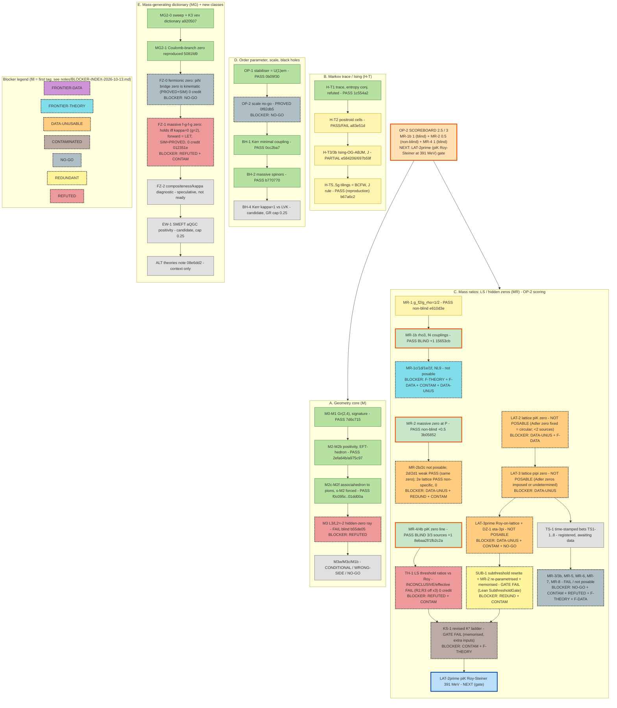

# Rung ladder (restructured 2026-10-13)
Rendered: `figures/rung-ladder-2026-10-13.png` (source `figures/rung-ladder-2026-10-13.mmd`). Ordered ladders per branch; orange border = OP-2 scoring rung; blue = next rung. The detailed traffic light (older layout) follows below.

---

# Trade-space traffic light: geometry only (2026-10-12)

Every node and edge is coloured from checker runs and run outputs made today, not from what the docs say.

## Build results (run 12 Oct 2026, ~18:50–)

| Target | Command | Result |
|---|---|---|
| the private research repository `lean/` @ 15653cb | `lake build` | **Build completed successfully (9005 jobs)**. Only linter warnings (IsingLoop.lean). `rg sorry` finds no `sorry` in the code, only "No `sorry`" doc comments. |
| `lean/AxiomsAll.lean` (stored output) | `AxiomsAll_output.txt` @ fedce56 | 336 theorems in 24 modules, **0 sorryAx**, at most {propext, Classical.choice, Quot.sound}. **Stale:** it predates `LSResidue` (MR-1/MR-1b). A fresh `lake env lean AxiomsAll.lean` **timed out at 600 s**, so it was not regenerated. |
| `PositiveGeometryEmergentSpaceTime.LSResidue` (MR-1, MR-1b) | `#print axioms` on all 11 theorems | All 11 have **only the standard 3 axioms**: `rho3_ratio` (=5/16), `f4_ratio` (=49/240), `rho3_residue`, `f4_residue`, `coupling_ratio` (=1/2), `gamma_two_step`, `kappa_*`. |
| UOPG repo @ 1565e7d (scratch copy `<local path>`, identical apart from 2 audit files; nothing pushed) | `lake exe cache get && lake build` | **Build completed successfully (3133 jobs)**. |
| UOPG `mvp0/ mvp1/ mvp2/ lemma/check.sh` | bash | All 4 **rc=0**. 47 `#print axioms` lines, **0 sorryAx**. |
| UOPG `UOPG.lean` (Mar) | `lake env lean` | Elaborates, **3 `sorry`**, 0 theorems. Not a proof. |
| UOPG `UOPGv2.lean` (Apr) | `lake env lean` | Elaborates, **8 `sorry`**. `harmonic_emergence` depends on sorryAx. Not a proof. |
| MR-1b run | `venv2/bin/python scripts/mr1b_data_check.py` | rc=0. The output is **identical** to the committed `mr1b_data_check_output.txt`. |
| UOPG notebooks / PDFs | not re-run today | Taken from `reviews/uopg-review-2026-10-09.md`. The PDFs have no text layer and were read as images in that review. |

## Legend

| Colour | Tags | Rule |
|---|---|---|
| 🟢 green | PROVED, SIMULATED | PROVED means the Lean checker passed today, with no sorry and only the standard axioms. SIMULATED means a script with committed output or a commit id. |
| 🟡 yellow | CONJECTURE; load-bearing CITED | An open claim, or one with only partial or numerical support. Also used where something is proved only inside an ansatz with an outside input. |
| 🔴 red | refuted, FAIL, no evidence | Pre-registered fail, sorry-based claims, or nothing yet. |
| ⚪ grey | CITED (neutral), SPECULATION shelf, frozen | Not load-bearing. |

Edges: solid green = the implication is itself proved or simulated. Yellow = conjectural or ansatz-dependent. Red = broken or refuted.

## Diagram

```mermaid
flowchart TD
  G0["Single ground: one positive geometry<br/>(PositiveGeometryEmergentSpaceTime) - CONJECTURE"]:::yellow

  subgraph UOPG["UOPG repo (savanc/UOPG-Emergent-Spacetime)"]
    U0["Paper layer: Hessian metric, mutations,<br/>W = 80.4 GeV (UOPG.lean / v2, PDFs)"]:::red
    U1["MVP-0: Plücker, Gr+(2,4) witness,<br/>Klein pairing = det, null momenta"]:::green
    U2["MVP-1: positive orthant chart,<br/>1/(xyzw), Parke–Taylor sign"]:::green
    U3["MVP-2: faces / residue shadow;<br/>paper mutation leaves Gr+ (refutation)"]:::green
    U4["Rank-one lemma; momentum misses t"]:::green
    U5["MVP-3 scale, MVP-4 helicity<br/>(unfilled contracts)"]:::red
  end

  subgraph ST["Spacetime layer"]
    M1["M1: Hermitian 2x2 gives Minkowski (1,3),<br/>Lorentz = SL2C"]:::green
    M1b["M1b: NO-GO, real positivity does not<br/>survive in (1,3)"]:::green
  end

  subgraph POS["Real positivity: spectral, not kinematic"]
    M2["M2: positivity bound l2 >= 27/20, data z=7.2"]:::green
    M2b["M2b: EFT-hedron Hankel f0 f2 >= f1^2"]:::green
  end

  subgraph NET["Network branch"]
    HT1["H-T1: Lam electrical networks into Gr>=0"]:::green
    HT2["H-T2: positroid cells and dims, star–triangle"]:::green
    HT3["H-T3/3b: Ising into OG>=0; loop factor J"]:::green
    HT5["H-T5/5b/5d: BCFW tiles = tree Ising (n=6,8,10)"]:::green
    HT5f["H-T5f: tile adjacency = associahedron flips"]:::green
    HT5g["H-T5g: vertex-chain rule, constant 2^k"]:::green
    HTc["Tile measure 2^(n-5) x carrier x J_V, all n"]:::yellow
    FZ["Network branch frozen"]:::grey
  end

  subgraph AMP["Amplitude / particle layer"]
    M2c["M2c: Tr phi^3 associahedron, residues"]:::green
    M2de["M2d-e: delta-shift to pions,<br/>forced at n=6 (ansatz)"]:::green
    M2f["M2f: mass shift s - M^2 (M = input)"]:::yellow
    MR2["MR-2: massive hidden zero A(M²,M²,2M²)=0,<br/>r = 0.000 ± 0.12 (CGL), -0.04 (BCEGS); non-blind"]:::green
    MR2b["MR-2b: blind lattice zero test,<br/>WELL-POSEDNESS FAIL (no lattice l1+l2)<br/>BLOCKER: DATA-UNUS + REDUND + CONTAM"]:::b_dataunusable
    M3["M3: hidden-zero L3/L2 - FAIL<br/>(weakened per audit)<br/>BLOCKER: REFUTED"]:::b_refuted
    M3cw["M3c/M3w: diagnosis, VMD edge passes"]:::yellow
    RG["Regge ladder: LS, alpha0=1/2 from Adler zero,<br/>m^2 = 1,3,5,7 m_rho^2"]:::green
    MR1["MR-1: f2/rho = 1/2 (non-blind) PASS"]:::green
    MR1b["MR-1b: BLIND rho3 5/16, f4 49/240,<br/>4/4 sources |z| <= 1.2"]:::green
    MR1c["MR-1c: f2-level I=0 scalar zero PROVED (Lean);<br/>test vs f0(1370): WELL-POSEDNESS FAIL<br/>BLOCKER: F-THEORY"]:::b_frontiertheory
    MR1d["MR-1d: rho' daughter R=1/2 PROVED (Lean);<br/>test vs rho(1450): WELL-POSEDNESS FAIL (pipi BR only seen)<br/>BLOCKER: F-DATA"]:::b_frontierdata
    NX["Next: MR-1d rho(1450) daughter 1/2, MR-2,<br/>n=8 symbolic, NL9"]:::red
    MR3["MR-3: m_pi/m_rho window, WELL-POSEDNESS FAIL;<br/>massive LS positivity forces m_pi=0 (Lean)<br/>BLOCKER: NO-GO + CONTAM"]:::b_nogo
    MR3b["MR-3b: LS g~rho^2=1/(2pi) vs data 0.50<br/>(KSRF) - FAIL x3.1, non-blind<br/>BLOCKER: REFUTED + CONTAM"]:::b_refuted
  end

  subgraph OPB["Order-parameter branch (OP-1, 2026-10-12)"]
    OP1["OP-1: Higgs vev and Minkowski eta are both<br/>stabiliser order parameters; H = U(1)em exactly,<br/>Stab(eta) = Lorentz (0 sorry)"]:::green
    OPa["(a) potential / norm so the orbit carries a scale"]:::yellow
    OPb["(b) M1 SL2C on Hermitian 2x2 as an instance;<br/>Physlib LorentzGroup bridge"]:::yellow
    OPc["(c) one magnitude for v and Lambda:<br/>f = Lambda^1/4 / v = 9.1e-15 ?"]:::red
    OPd["(d) chiral condensate instance;<br/>m_rho from same order parameter?"]:::red
  end

  SC["Mass scale gap: m_rho is an input<br/>(zero-parameter milestone not met)"]:::red
  OP2["OP-2: scale no-go (Lean ScaleNoGo, 9 thms)<br/>stabiliser data and LS are scale-blind; input ledger - PROVED<br/>BLOCKER: NO-GO"]:::b_nogo
  subgraph MGD["Mass-generating dictionary: one unit + geometric ratios (added 2026-10-13)"]
    MG1["(1) spurion NLSM / massive hidden zeros -> LEC relations<br/>SU(2): MR-2 PASS non-blind, MR-2b not posable"]:::yellow
    MR2c["MR-2c: SU(3) massive hidden zero -> L5/L8:<br/>WELL-POSEDNESS FAIL (needs L0-L3, Gate 4 stop)<br/>BLOCKER: DATA-UNUS + CONTAM"]:::b_dataunusable
    MG2["(2) SSB gauge bridge to W/Z/H: K3 dictionary frozen (MG2-0);<br/>MG2-1 Coulomb-branch zero reproduced, |A|/ref<3e-14 (SIMULATED), eq57+D1 PROVED;<br/>W/Z/H data test not posable (doublet, g'/g, lambda)"]:::yellow
    MG3["(3) one unit S={m_rho,m_pi,f_pi} + zero extra params<br/>= OP-2 milestone; score 1.5/3; constraints MR-3, MR-3b"]:::yellow
    MG4["(4) geometric origin of the unit: transmutation,<br/>compactification, dynamical vev - SPECULATION"]:::red
  end
  GR["Gravity / metric - parked"]:::red
  BH1["BH-1: Kerr = minimal spinor coupling<br/>Lean PASS (kinematics + exp limit + multipoles, 0 sorry);<br/>Kerr identification CITED, non-blind"]:::green
  GR --> BH1
  BH2["BH-2: massive spinor helicity (AHH)<br/>Lean PASS: Λ Λ̃ᵀ decomp, SU(2) LG, brackets, x-factor, 0 sorry;<br/>(d) minimal = unique bounded structure (scalarised power counting)"]:::green
  BH1 --> BH2
  BH2 -. "full tensor uniqueness / Compton: OPEN" .-> GR

  subgraph SH["Shelf (not load-bearing)"]
    W["Weinstein GU: no peer review"]:::grey
    SK["Skyrmions"]:::grey
    OI["OIST result"]:::grey
    BA["Bandyopadhyay time crystals<br/>(unreplicated)"]:::grey
    NL9["Nine-loop N=4 SYM (CITED)"]:::grey
  end
  NL9r["NL9: blind positivity test of E9,<br/>WELL-POSEDNESS FAIL (no weight-18 evaluator;<br/>only (1,1,1) cheap, already seen)<br/>BLOCKER: DATA-UNUS"]:::b_dataunusable

  G0 --> U0
  G0 --> U1
  U1 --> U2
  U2 --> U3
  U3 --> U4
  U4 --> U5
  U0 --> U3
  U1 --> M1
  M1 --> M1b
  M1b --> M2
  M2 --> M2b
  M1b --> HT1
  HT1 --> HT2
  HT2 --> HT3
  HT3 --> HT5
  HT5 --> HT5f
  HT5f --> HT5g
  HT5g --> HTc
  HTc --> FZ
  M2b --> M2c
  M2c --> M2de
  M2de --> M2f
  M2f --> M3
  M3 --> M3cw
  M3cw --> RG
  RG --> MR1
  MR1 --> MR1b
  MR1b --> NX
  M2f --> SC
  MR1b --> SC
  SC --> GR
  G0 -.-> SH
  M1 --> OP1
  OP1 --> OPa
  OP1 --> OPb
  OPa --> OPc
  OPc --> SC
  OP1 --> OPd
  OPd --> MR1b
  OP1 --> SC

  MR1b --> MR1c
  MR1c -.-> NX
  MR1c --> MR1d
  M2f --> MR2
  subgraph LEG["Blocker legend (fill = first tag; see notes/BLOCKER-INDEX-2026-10-13.md)"]
    direction LR
    L_b_frontierdata["FRONTIER-DATA"]:::b_frontierdata
    L_b_frontiertheory["FRONTIER-THEORY"]:::b_frontiertheory
    L_b_dataunusable["DATA-UNUSABLE"]:::b_dataunusable
    L_b_contaminated["CONTAMINATED"]:::b_contaminated
    L_b_nogo["NO-GO"]:::b_nogo
    L_b_redundant["REDUNDANT"]:::b_redundant
    L_b_refuted["REFUTED"]:::b_refuted
  end
  classDef green fill:#2e7d32,color:#fff,stroke:#1b5e20
  classDef yellow fill:#f9a825,color:#000,stroke:#f57f17
  classDef red fill:#c62828,color:#fff,stroke:#8e0000
  classDef grey fill:#9e9e9e,color:#000,stroke:#616161

  MR2 --> MR2b
  RG --> MR3
  MR3 --> MR3b
  linkStyle 0 stroke:#f9a825,stroke-width:2px
  linkStyle 1 stroke:#f9a825,stroke-width:2px
  linkStyle 2,3,4 stroke:#2e7d32,stroke-width:2px
  linkStyle 5 stroke:#c62828,stroke-width:2px
  linkStyle 6 stroke:#c62828,stroke-width:2px
  linkStyle 7,8 stroke:#2e7d32,stroke-width:2px
  linkStyle 9 stroke:#f9a825,stroke-width:2px
  linkStyle 10 stroke:#2e7d32,stroke-width:2px
  linkStyle 11 stroke:#f9a825,stroke-width:2px
  linkStyle 12,13,14,15,16 stroke:#2e7d32,stroke-width:2px
  linkStyle 17 stroke:#f9a825,stroke-width:2px
  linkStyle 18 stroke:#9e9e9e,stroke-width:2px
  linkStyle 19 stroke:#f9a825,stroke-width:2px
  linkStyle 20,21 stroke:#2e7d32,stroke-width:2px
  linkStyle 22 stroke:#c62828,stroke-width:2px
  linkStyle 23 stroke:#2e7d32,stroke-width:2px
  linkStyle 24 stroke:#f9a825,stroke-width:2px
  linkStyle 25,26 stroke:#2e7d32,stroke-width:2px
  linkStyle 27 stroke:#c62828,stroke-width:2px
  linkStyle 28,29,30 stroke:#c62828,stroke-width:2px
  linkStyle 31 stroke:#9e9e9e,stroke-width:1px
  linkStyle 32 stroke:#2e7d32,stroke-width:2px
  linkStyle 33,34 stroke:#f9a825,stroke-width:2px
  linkStyle 35,36 stroke:#c62828,stroke-width:2px
  linkStyle 37,38 stroke:#c62828,stroke-width:2px
  linkStyle 39 stroke:#f9a825,stroke-width:2px
  linkStyle 40 stroke:#c62828,stroke-width:2px
  linkStyle 41 stroke:#9e9e9e,stroke-width:1px
  linkStyle 42 stroke:#c62828,stroke-width:2px
  linkStyle 43 stroke:#2e7d32,stroke-width:2px
  NL9 --> NL9r
  linkStyle 44 stroke:#c62828,stroke-width:2px
  linkStyle 45 stroke:#c62828,stroke-width:2px
  OP1 --> OP2
  OP2 -. "explains why" .-> SC
  MR2 --> MG1
  MR2b --> MG1
  MG1 --> MR2c
  MR2c --> MR2d
  MR2d --> MR2d1
  MG1 --> MR4
  MR4["MR-4 (BLIND): piK hidden-zero line s=Mpi^2+MK^2<br/>PASS both: BDM r=0.34+-0.11, LP 0.10; null f 0.12/0.07<br/>MR-4b PR2020: r=0.27+-0.07, f=0.11; 3/3 sources<br/>counted +1 (the author): OP-2 = 2.5/3"]:::green
  MR1e["MR-1e: rho5/f6 couplings - WELL-POSEDNESS FAIL<br/>BLOCKER: F-DATA"]:::b_frontierdata
  MR1b -.-> MR1e
  MR1f["MR-1f: K* LS couplings - FAIL (not blind, theory not ready)<br/>BLOCKER: CONTAM + F-THEORY"]:::b_contaminated
  MR6["MR-6: K->3pi Dalitz zero - FAIL (zero locus unphysical, PROVED)<br/>BLOCKER: NO-GO + F-THEORY"]:::b_nogo
  MR1b -.-> MR1f
  MR4 -.-> MR6
  MR5["MR-5: pi-eta / K-eta lines - FAIL (no CGW-form zero)<br/>BLOCKER: F-THEORY + F-DATA"]:::b_frontiertheory
  MR2e["MR-2e: R=2(2L6-L4)+(2L8-L5)=0 vs FLAG T25<br/>4/4 PASS, NDA f=0.04 but large-Nc null f=0.79 - weak<br/>BLOCKER: REDUND + CONTAM"]:::b_redundant
  MR4 -.-> MR5
  MR4 --> MR2e
  MR7["MR-7: piN hidden-zero line - FAIL (no LO zero; u-pole on line, PROVED)<br/>BLOCKER: NO-GO + F-THEORY"]:::b_nogo
  MR8["MR-8: Delta Regge couplings - FAIL (theory not ready)<br/>BLOCKER: F-THEORY + CONTAM"]:::b_frontiertheory
  MR4 -.-> MR7
  MR1b -.-> MR8
  MR2d1["MR-2d1 (NON-BLIND) one-loop, mu-indep.:<br/>r=+0.003 (BE14), -0.039 (GL85); refits |r|<=0.11, NDA f 0.06-0.08 - weak PASS"]:::yellow
  MR2d["MR-2d (NON-BLIND): Z=4(2L1+L2+L3)+16(2L6-L4)+8(2L8-L5)=0<br/>PASS weak: BE14 Z=-5.7+-6.0e-3, null f=0.09; GL85 f=0.51"]:::yellow
  OP1 -. "stabiliser = U(1)em" .-> MG2
  BH2 -. "massive 3-pt language" .-> MG2
  OP2 --> MG3
  MR3b -. "constraint" .-> MG3
  MR3 -. "constraint: m_q input" .-> MG4
  OP2 -. "no-go: must break scale-blindness" .-> MG4
  MG4 -. "would close" .-> SC
  MR4 -.-> TH1["TH-1: LS threshold ratios vs Roy - effective FAIL<br/>BLOCKER: REFUTED + CONTAM"]:::b_refuted
  TH1 -.-> KS1["KS-1: K* ladder couplings - GATE FAIL<br/>BLOCKER: CONTAM + F-THEORY"]:::b_contaminated
  MR2 -.-> LAT3["LAT-3: lattice pipi zero - NOT POSABLE<br/>BLOCKER: DATA-UNUS"]:::b_dataunusable
  MR4 -.-> LAT2["LAT-2: lattice piK zero - NOT POSABLE<br/>BLOCKER: DATA-UNUS + F-DATA"]:::b_dataunusable
  LAT3 -.-> LAT3p["LAT-3prime Roy@391 MeV - NOT POSABLE<br/>BLOCKER: DATA-UNUS + CONTAM"]:::b_dataunusable
  MR6 -.-> DZ1["DZ-1: eta->3pi zero line - GATE FAIL (Lean EtaGate)<br/>BLOCKER: NO-GO + DATA-UNUS + CONTAM"]:::b_nogo
  MR2 -.-> SUB1["SUB-1: subthreshold rewrite = MR-2 - GATE FAIL<br/>BLOCKER: REDUND + CONTAM"]:::b_redundant
  MG2 -.-> FZ0["FZ-0: piN bridge zero kinematic - 0 credit<br/>BLOCKER: NO-GO"]:::b_nogo
  FZ0 --> FZ1["FZ-1: f-g-f-g zero iff kappa=0 - 0 credit<br/>BLOCKER: REFUTED + CONTAM"]:::b_refuted
  classDef b_frontierdata fill:#ce93d8,stroke:#333,stroke-width:2px,stroke-dasharray:4 2;
  classDef b_frontiertheory fill:#80deea,stroke:#333,stroke-width:2px,stroke-dasharray:4 2;
  classDef b_dataunusable fill:#ffcc80,stroke:#333,stroke-width:2px,stroke-dasharray:4 2;
  classDef b_contaminated fill:#bcaaa4,stroke:#333,stroke-width:2px,stroke-dasharray:4 2;
  classDef b_nogo fill:#b0bec5,stroke:#333,stroke-width:2px,stroke-dasharray:4 2;
  classDef b_redundant fill:#fff59d,stroke:#333,stroke-width:2px,stroke-dasharray:4 2;
  classDef b_refuted fill:#ef9a9a,stroke:#333,stroke-width:2px,stroke-dasharray:4 2;
```

## OP-1 update (added 2026-10-12, later the same evening)

Build: `lake build` 9006 jobs OK; `PositiveGeometryEmergentSpaceTime.OrderParameter` 19 declarations, all standard axioms, 0 sorry
(the draft's `gauge_unbroken_eq_em` sorry was closed). See reviews/OP-1-result-2026-10-12.md and
notes/OP-1-prior-art-2026-10-12.md.

| Node / edge | Colour | Evidence / verdict |
|---|---|---|
| OP-1 | 🟢 PROVED | Lean, 0 sorry. Physics is standard (Landau/Kibble; Percacci 1991 for the metric). Exploratory, not pre-registered. |
| M1 → OP-1 | 🟢 | Both are proved Lorentz-structure statements; OP-1's η stabiliser is the 4×4 form of M1's group. Link is a reading, not a theorem (that is direction b). |
| OP-1 → SC | 🟡 | Scale-blind: the class sees G/H only, so it does not touch the mass-scale gap. |
| (a) potential/norm | 🟡 | Doable in Lean (V(φ)=λ(|φ|²−v²)², minimum set = orbit). But the minimum still contains v as input, so on its own it moves the scale, it does not remove it. Percacci 1991 did the physics. **Verdict: only as a tool for (c), not a rung by itself.** |
| (b) M1 SL2C instance | 🟡 | Cheap and fully provable: SL(2,ℂ) acting on Hermitian 2×2 by X↦AXA†, stabiliser of 1 = SU(2), det preserved = Minkowski norm; plus Physlib `LorentzGroup` bridge. Unifies M1 with OP-1. Low physics value. **Verdict: worth a small housekeeping rung (OP-1b), 1–2 h.** |
| (c) one magnitude | 🔴 | No candidate f exists. Counting today: dimensionful inputs are v, ρ_Λ, m_ρ (≈Λ_QCD), plus M_Pl for gravity. A shared class does not lower that count. **Verdict: worth one pre-registered counting/no-go rung (OP-2): state precisely what extra structure would be needed for f to be computable; expected outcome is a proved "scale-blind ⇒ no relation" lemma plus the input ledger. High clarity, low odds of a positive result.** |
| (d) chiral / MR-1b link | 🔴 | The QCD chiral condensate (SU(2)L×SU(2)R → SU(2)V, order parameter ~f_π) is a genuine third instance (cheap to add). But m_ρ is set by Λ_QCD via dimensional transmutation and barely depends on v, so "m_ρ from the same order parameter" has no support and is physically disfavoured. **Verdict: the instance is cheap (fold into OP-1b); the scale link is red, not worth a rung.** |
| OP-1 → (a),(b) | 🟡 | Open directions. |
| (a) → (c), (c) → SC, OP-1 → (d), (d) → MR-1b | 🔴 | No evidence; (d)→MR-1b physically disfavoured. |

**Net effect:** one green node, zero change to the milestone. The order-parameter view is a clean language for
"what is broken", but every dimensionful input survives it.

## Evidence per node

- **G0 Single ground (yellow, CONJECTURE).** This is the mission hypothesis in MISSION.md. No single theorem derives the layers below from one object.
- **U0 UOPG paper layer (red).** `UOPG.lean` has 3 sorry and 0 theorems. `UOPGv2.lean` has 8 sorry and `harmonic_emergence` uses sorryAx. The W mass is calibrated to 80.4 by construction (uopg-review-2026-10-09 §3). The "mutation" is refuted by `UOPG0/Boundary.lean:112`.
- **U1 MVP-0 (green, PROVED).** `UOPG0/Plucker.lean` `plucker_relation`, `Positive.lean`, `Klein.lean`, `Momenta.lean`. mvp0/check.sh rc=0, 0 sorryAx.
- **U2 MVP-1 (green, PROVED).** `UOPG0/Canonical.lean` (`parkeTaylorCoeff_witness`, `positiveExample_gauge`). mvp1/check.sh rc=0.
- **U3 MVP-2 (green, PROVED).** `UOPG0/Boundary.lean` (`residue_drop_z_witness`, `face_x_P13_witness`, mutation counterexample). mvp2/check.sh rc=0.
- **U4 Rank-one lemma (green, PROVED).** `UOPG0/RankOne.lean` (`matrix_invariant_along_rescale`, `edge0_momentum_misses_t`, PR #5). lemma/check.sh rc=0.
- **U5 MVP-3/4 (red, no evidence).** Only contracts exist in docs/ROADMAP.md, with no Lean.
- **M1 (green, PROVED).** `PositiveGeometryEmergentSpaceTime/Lorentz.lean`, `Spinor.lean`, `Klein.lean`, `Null.lean`, `LightCone.lean` built in today's lake build. reviews/M1-result.
- **M1b (green, PROVED no-go).** reviews/M1b-result. The no-go theorems are in today's build. It is green because the negative result is proved; it closes *strict* (open-region) kinematic positivity in (1,3) at n = 5. *Narrowed wording (H1, approved by author approved (2026-10-20)): the boundary case (some planar X = 0) is open. Superseded wording: "it closes kinematic positivity in (1,3)". The mermaid label "real positivity does not survive in (1,3)" above is read the same way (strict).*
- **M2 (green, PROVED + data).** `PositiveGeometryEmergentSpaceTime/Dispersion.lean`, `PionBound.lean`. Data z = 7.15 (reviews/M2-result). The bound is prior art (Adams et al. 2006).
- **M2b (green, PROVED).** `PositiveGeometryEmergentSpaceTime/Hankel.lean`. The toy checks are SIMULATED (reviews/M2b-result). Prior art: AHH 2020.
- **HT1 (green).** `PositiveGeometryEmergentSpaceTime/Network.lean` plus `scripts/ht1_lam_concordance_output.txt`.
- **HT2 (green).** `PositiveGeometryEmergentSpaceTime/PositroidCells.lean` (17 thms) plus `ht2_cells_output.txt` (302 networks, 0 fails).
- **HT3/3b (green).** `IsingOG.lean` (10) and `IsingLoop.lean` (7). The Lee-measure J_Y and J_Δ derivation is sympy-exact, not Lean: `ht3b_symbolic_n3_output.txt`.
- **HT5/5b/5d (green).** `IsingTiling.lean`, `IsingTiling8.lean`, `IsingTiling10.lean` (19 thms) plus `ht5_tiling_output.txt`. Gates 40/40 and 56/56 exact round-trips.
- **HT5f (green, exact computation).** `ht5f_adjacency_output.txt` and `Associahedron.lean`: pentagon at n = 10, K5 with 21 edges at n = 12.
- **HT5g (green, SIMULATED).** `ht5g_stage1/2.json`. Spread 5e-25, and the constant is a power of 2. The predicted value 2^(k−1) = 16 was not what came out (see the review).
- **HTc 2^(n−5) rule for all n (yellow, CONJECTURE).** Fitted numerically at n ≤ 12. No proof.
- **FZ Frozen (grey).** Decision status, not a claim.
- **M2c (green, PROVED).** `Associahedron.lean` (30 thms: residues, facets, soft limit). Prior art: ABHY.
- **M2d-e (green, PROVED + script).** `NLSM.lean`, `ShiftForced.lean`, `ShiftForcedConverse.lean`. It is forced only within the linear-shift ansatz. Some steps are script-only (reviews/M2e).
- **M2f (yellow).** `MassShift.lean` proves the structure. The value of M is an input, so it gives no prediction.
- **M3 (red, FAIL).** The pre-registered FAIL is proved in Lean as `be14_fail` and `be14_gap` (`LECRatio.lean`). The M3 audit downgraded the evidence ("FAIL stands, weaker"), because no unitary large-N completion could reach the data.
- **M3c/M3w (yellow).** `Coon.lean` and `vmd_edge_passes_m3_rule` are proved. The interpretation (α0 = [1/2]_q is our choice) is open.
- **RG Regge/LS (green, PROVED + CITED).** `LSResidue.lean` `gamma_two_step`, `rho_residue`, `f2_residue`, `rho3_residue`, `f4_residue`, all with standard axioms only (checked today). The LS amplitude itself is CITED (Lovelace 1968, Shapiro 1969).
- **MR-1 (green, SIMULATED, non-blind).** `scripts/mr1_data_check_output.txt` and `mr1_ls_prediction_output.txt`, commit e610d3e. R_g 0.663 and 0.713 against 1/2, z ≈ 1.0 and 1.2.
- **MR-1b (green, SIMULATED).** Prereg cdef00b, then result commit 15653cb. `scripts/mr1b_theory_output.txt` and `mr1b_data_check_output.txt`. Re-run today: identical output. LS gives 5/16 and 49/240 (Lean `rho3_ratio`, `f4_ratio`). Data/LS ratios: ρ3 0.79 (PDG) and 1.49 (CORDEN79); f4 0.91 and 1.05. All four have |z| ≤ 1.2. It is blind on the couplings only; the masses and widths were partially exposed.
- **NX Next rungs (red, no evidence yet).** Not started.
- **SC Mass scale gap (red).** m_ρ is still an input everywhere (M2f, MR-1b), so the zero-parameter milestone is not met.
- **BH-1 (green, 2026-10-12, under GR).** Formalisation only: little group, (1+y/2s)^{2s}→e^y, c(2s,ℓ)→1/ℓ!, ℓ>2s vanishing, M_ℓ+iS_ℓ=m(ia)^ℓ PROVED (`PositiveGeometryEmergentSpaceTime.KerrMinimal`). Kerr = classical limit of minimal coupling is CITED (AHH, GOV, CHKL, AHO). GR node itself stays red. See reviews/BH-1-result-2026-10-12.md.
- **GR Gravity (red, parked).** No evidence. "Metric as a section" is SPECULATION (notes/carrier-bundles-weinstein).
- **Shelf (grey).** Weinstein GU is SPECULATION with no peer review. Skyrmions and OIST are not load-bearing. Bandyopadhyay is REPORTED-UNREPLICATED (reviews/bandyopadhyay-…). Nine-loop SYM is CITED (primary-source-shelf).

## Edge evidence

- **Yellow edges:**
  - G0→U0 and G0→U1: the mission hypothesis.
  - M1b→M2: a reframing of "where positivity lives", not an implication.
  - M1b→HT1: motivation only.
  - HT5g→HTc: an extrapolation.
  - M2b→M2c: a programme link.
  - M3cw→RG: the diagnosis motivates LS; it does not imply it. (M3→M3cw is green: proved in `Coon.lean`.)
- **Red edges:**
  - U4→U5: no rung exists yet.
  - U0→U3: the paper's mutation is refuted there.
  - M2f→M3: a pre-registered FAIL.
  - MR-1b→NX: not started.
  - M2f→SC and MR-1b→SC: the scale is an input, not derived.
  - SC→GR: nothing yet.
- **Green edges:** all the rest. Either a Lean theorem or a committed script output carries the step. For example, U1→M1: the Klein det pairing is fixed to (1,3) by the Hermitian structure. And RG→MR-1→MR-1b: the `LSResidue` ratios feed the run scripts.

## Discrepancies found

1. **`AxiomsAll_output.txt` is stale** (fedce56, 16:02). It does not cover `LSResidue`. MISSION requires an AxiomsAll run at every rung. I verified `LSResidue` separately, with 11 theorems and standard axioms only. A full regeneration timed out at 600 s, so it needs a longer run.
2. **UOPG `UOPG.lean` and `UOPGv2.lean`:** 3 and 8 `sorry`. The PDFs ("Formally Verified in Lean 4 … a mathematical theorem", Grassmannian_Emergence slide 18) and uopgv2.tex §9 overclaim. The "exact" W mass is a calibration, not a prediction.
3. The UOPG paper's "mutation preserves positivity" is **refuted** by its own MVP-2 Lean (`Boundary.lean:112`).
4. In the UOPG README, `Article.pdf` is linked but missing. `uopgv2.ipynb` is not valid JSON; it is a Python script.
5. The `.lake/packages/*` "local changes" warnings in the private research repository are harmless to the build but affect reproducibility. A clean re-fetch is recommended.
6. **MR-1b:** "blind" applies to the coupling ratios only, since the inputs were partially exposed. The ±36% and ±42% bands are wide. It is support, not the zero-parameter milestone.
7. **H-T5g:** the pre-registered constant 16 was not what came out. PASS was given only under the "power of 2" clause.

## Update 2026-10-12: MR-1c
- **MR1c (red):** the exact zero (no I=0 scalar at m²=3m_ρ²) is PROVED in Lean (`f2_level_I0_scalar_zero`, standard axioms) and was already noted by Bianchi–Consoli–Di Vecchia 2002.05419 (CITED). The *test* is red: pre-data well-posedness FAIL (LS scalar sector fails at level 1; f0(1370) disputed/broad; scalar glueball mixing O(1); not blind). Prereg f941ef8. No data run.
- Edge MR1b→MR1c red (no transferable evidence); MR1c⇢NX grey (redirects to MR-1d ρ(1450)).

- **MR1d (red):** R=1/2 PROVED (`rho_daughter_ratio`); test pre-registered (5ed40ab) but NOT POSED: PDG lists rho(1450)->pipi only as 'seen'; at most one absolute BR (CLEGG 94, no error). Indicative (SPECULATION) values lean low (R~0.08-0.26 vs 0.5). Edge MR1c->MR1d red.

- **MR2 (green, SIMULATED + PROVED algebra):** Lean `MassiveZero` (0 sorry, standard axioms) proves massive hidden zero ⇒ A(P)=0 at P=(M²,M²,2M²) and the O(p⁴) iff (a2=2a1 ∧ 4a1+2a3+a4=0). Data: two-loop BCEGS representation with CGL b̄ (r = −0.0002 ± 0.12) and BCEGS set II (r = −0.04), band 1/3, discrimination f = 0.35 < 0.5 → PASS. Prereg ca6c964. Caveats: non-blind (b̄ seen during gate), P unphysical (dispersive access only), single-trace assumption, M and F still inputs. Edge M2f→MR2 green. Does not move SC.
- **MR2b (red):** blind lattice version NOT POSED (pre-data): R(P) needs ℓ̄1+ℓ̄2 and two-loop r_i; FLAG 2024 omits LECs, FLAG 2019 gives only ℓ̄1−ℓ̄2; P subthreshold so no Lüscher access at any M_π. Edge MR2→MR2b red. See reviews/MR-2b-result-2026-10-12.md.

- **NL9r (red):** blind positivity test of the nine-loop BDS-like MHV amplitude NOT POSED (pre-data). Conjecture (Dixon–von Hippel–McLeod–Trnka 1611.08325): sign (−1)^L in the positive region. Generic points need numerical weight-18 hexagon-function evaluation (no tool on box); the cheap point (1,1,1) was already displayed on the Cosmic9 page (E9/E8 = −14.11, sign alternation consistent, non-blind, 1 bit). Edge NL9→NL9r red. See reviews/NL9-result-2026-10-12.md.
- **MR3 (red):** m_π/m_ρ not posed: minimal massive LS family is one-parameter in r; f₂-level scalar coefficient r(2r−1)/(4(r−1)²)<0 ⇒ positivity forces r=0 (PROVED, PositiveGeometryEmergentSpaceTime.MassiveLS). **MR3b (red):** chiral-limit LS gives g²f_π²/m_ρ² = 1/(2π)=0.159; PDG+FLAG give 0.50 (0.44 with chiral-limit F): FAIL, factor ≈3 (=π vs KSRF), non-blind. See reviews/MR-3-result-2026-10-12.md.

- **OP2 (green, PROVED no-go):** `PositiveGeometryEmergentSpaceTime.ScaleNoGo` (9 theorems, std axioms, 0 sorry): stabiliser/orbit data invariant under v↦c·v; no function of it fixes a magnitude (`no_magnitude`) or an independent-sector ratio (`no_cross_ratio`); LS family invariant under (s,u,m²)↦λ(s,u,m²) (`LS_scale`). Input ledger + operational milestone in MISSION.md. SC stays red (now explained, not closed). See reviews/OP-2-result-2026-10-12.md.
## Update 2026-10-13: mass-generating dictionary (MGD) branch
Added from the author's external analysis; see reviews/PLAN-UPDATE-2026-10-13.md. Diagram re-rendered with mmdc (Chrome --no-sandbox), renders OK.
- **MG1 (yellow):** spurion NLSM / massive hidden zeros → LEC relations. SU(2) part done: MR-2 PASS non-blind (r ≈ −0.0002, CGL), MR-2b WELL-POSEDNESS FAIL. Prior art CGW 2601.16860 (CITED).
- **MR2c (red, 2026-10-13):** Gate 1 (Lean, `PositiveGeometryEmergentSpaceTime.MassiveZeroSU3`, 6 thms, 0 sorry, std axioms): at P the zero condition is αA/2 + 2c5 + c8 = 0 with kinematic single-trace weight SA(P)=1/2 ≠ 0, so it needs L0–L3-type LECs not in FLAG 2019 Table 25 → Gate 4 STOP. No FLAG values read. See reviews/MR-2c-result-2026-10-13.md.
- **MG2 (yellow):** spontaneously broken gauge theory bridge; hidden zeros survive there but not for naive massive YM (CGW, CITED). Links OP-1 (U(1)em stabiliser, PROVED) and BH-2 (massive spinor helicity, PROVED). Needs a pre-registered vev dictionary (K3).
- **MG3 (yellow):** = OP-2 operational milestone (S = {m_ρ, m_π, f_π}, N ≥ 3, score 1.5/3). Constraints: MR-3 (positivity forces m_π = 0, PROVED), MR-3b (×π vs KSRF, FAIL).
- **MG4 (red):** geometric origin of the unit; candidates SPECULATION. OP-2 no-go says any mechanism must break scale-blindness of stabiliser data.

- **MR2d (yellow, 2026-10-13, NON-BLIND):** SU(3) zero condition derived (tree, SIMULATED; algebra PROVED `PositiveGeometryEmergentSpaceTime.MassiveZeroSU3Phys`). Pass in BE14 NNLO/p4/GL85; discriminating only for BE14 NNLO (null f=0.09). Weak.

- **MR2d1 (yellow, 2026-10-13, NON-BLIND):** one-loop SU(3)→SU(2), μ-independent; PASS both sources; weak (see reviews/MR-2d1-result-2026-10-13.md). Lean `PositiveGeometryEmergentSpaceTime.MassiveZeroOneLoop`.

- **MG2 update 2026-10-13:** MG2-0 sweep + K3 frozen (a920507); MG2-1 reproduction PASS (reviews/MG2-1-result-2026-10-13.md, Lean `PositiveGeometryEmergentSpaceTime.CoulombZero`). Still yellow: no data-facing test posable.

- **MR4 (green, 2026-10-13, BLIND):** πK hidden-zero line vs Roy–Steiner subthreshold parameters, PASS in BDM and Lang–Porod, null f 0.12/0.07. Candidate +1 for OP-2 pending the author. **MR1e (red):** PDG has no quantitative ≥2-source ππ BR for ρ5/f6.

- **OP-2 official 2.0/3 (2026-10-13, the author):** MR-1b 1 + MR-2 0.5 + MR-4 0.5.

- **MR-4b (2026-10-13, BLIND):** Peláez–Rodas 2020 PASS (r = 0.27 ± 0.07, f = 0.11); 3/3 sources; MR-4 qualifies for full +1 pending the author.

- **OP-2 official 2.5/3 (author approved 2026-10-13):** MR-1b 1 + MR-2 0.5 + MR-4 1. Caveats: the MR-4 zero is approximate (~20%), sources share data, theory overlaps MR-2.

- **MR1f, MR6 (red, 2026-10-13):** gates failed; see reviews/MR-1f-MR-6-gates-2026-10-13.md.

- **MR5 (red), MR2e (yellow, 2026-10-13):** MR-5 not posable; MR-2e lattice cross-check of MR-4 PASS 4/4 but non-specific (large-N_c expectation). No credit proposed.

- **MR7, MR8 (red, 2026-10-13):** see reviews/MR-7-MR-8-gates-2026-10-13.md.
