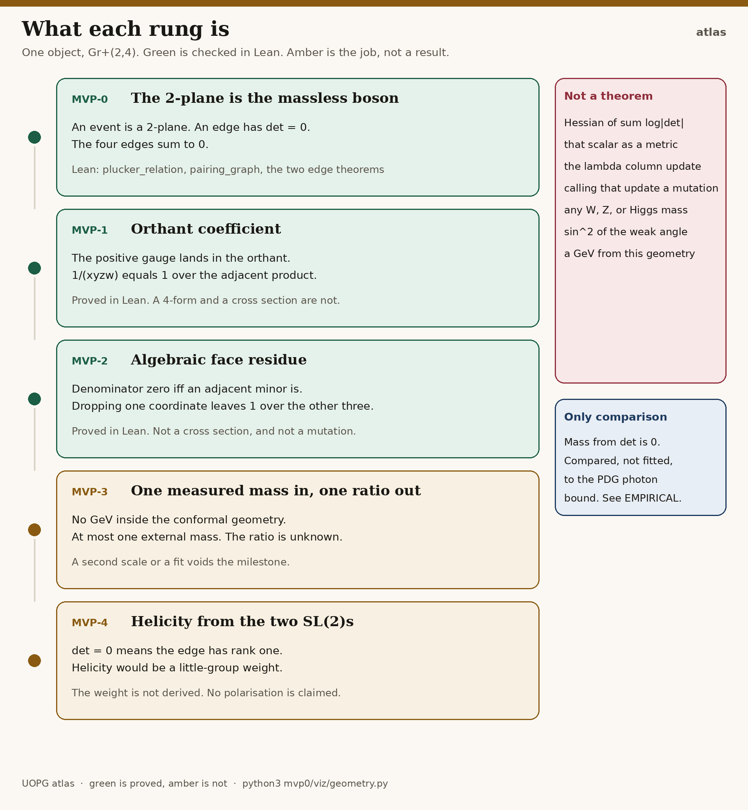

# UOPG

One object: the positive Grassmannian `Gr⁺(2,4)`. Spacetime is its Klein correspondence. A particle is not a theorem of this repository.

What is proved, and what is only a contract, is the status below. The title and abstract of the 2026 paper are kept afterwards, word for word, as a historical record. They are not the status of the proofs. The Zenodo record is left as published.

## Status

The mission is unchanged: spacetime and particles come from one positive Grassmannian, and the Standard Model is a geometric bootstrap from that field. The map of what is proved and what is only a contract is [docs/ROADMAP.md](docs/ROADMAP.md).



The first checked piece is [MVP-0](mvp0/README.md). It proves the Klein dictionary for `Gr⁺(2,4)`: the Plücker relation, the real `GL(2)` weight, one positive rational point, null separation, and four massless conserved edge momenta. The only experimental comparison is the PDG photon-mass bound, with no fitted scale. See [mvp0/DICTIONARY.md](mvp0/DICTIONARY.md).

The second checked piece is [MVP-1](mvp1/README.md). In the gauge that fixes columns 0 and 2, the positive chamber is the orthant, and the coefficient `1/(x y z w)` equals both `1` over the adjacent product and minus the cyclic Parke–Taylor coefficient. On the witness those numbers are `16/3` and `−16/3`. That is not a differential form, not a helicity, and not a cross section. See [mvp1/DICTIONARY.md](mvp1/DICTIONARY.md).

The third checked piece is [MVP-2](mvp2/README.md). The denominator vanishes exactly when one adjacent minor does. Cancelling one positive coordinate leaves `1` over the other three: `8/3` or `8` on the witness. `P13` stays positive on each face. One column shift at this witness sends `P23` from 1 to 0. That is not a mutation and not a cross section. See [mvp2/DICTIONARY.md](mvp2/DICTIONARY.md).

The rank-one lemma is [lemma/README.md](lemma/README.md). A singular `2 × 2` matrix is an outer product, and `u → t u`, `v → v / t` leaves it fixed. On the polygon the four edges match the factors in the shadow, including the rescaling at `t = 2`. That is not a helicity, and it does not turn the MVP-4 card green. MVP-3 stays blank. See [lemma/DICTIONARY.md](lemma/DICTIONARY.md).

The ladder on `Gr⁺(2,4)` is frozen. There is no further rung. The factorisation of a null edge is not unique: `t = 2` moves the edge-0 factor from `(−2, 0)` to `(−4, 0)` and leaves the momentum fixed. The corollary that every function of that momentum is unchanged does not rule out a helicity. MVP-4 stays a contract.

`UOPG.lean` and `UOPGv2.lean` are drafts from March and April 2026. They are not kernel-checked proofs. `m_W = 80.4 GeV` is not a theorem of this repository.

- **Paper**: [article.pdf](https://doi.org/10.5281/zenodo.19291218)
- **Zenodo DOI**: [10.5281/zenodo.19291218](https://doi.org/10.5281/zenodo.19291218)
- **MVP-0 (proved)**: [mvp0/README.md](mvp0/README.md)
- **MVP-1 (proved coefficient, not an amplitude)**: [mvp1/README.md](mvp1/README.md)
- **MVP-2 (proved face residue, not a cross section)**: [mvp2/README.md](mvp2/README.md)
- **Rank-one lemma (not a helicity, MVP-4 stays a contract)**: [lemma/README.md](lemma/README.md)
- **Lean 4 formalisation (draft concept)**: [UOPGv2.lean](UOPGv2.lean)
- **Numerical notebook**: [uopgv2.ipynb](uopgv2.ipynb)
- **Slide Deck**: [UOPG v2 Slide deck](https://github.com/savanc/UOPG-Emergent-Spacetime/blob/main/Unified_Positive_Geometry.pdf)
  
## PositiveGeometryEmergentSpaceTime: the follow-on programme

The folder [`PositiveGeometryEmergentSpaceTime/`](PositiveGeometryEmergentSpaceTime/README.md) holds the follow-on programme: can a positive-geometry structure, checked in Lean, fix a dimensionless Standard-Model quantity with zero fitted parameters? It is ongoing research. Every test is preregistered before it runs, graded by a locked checker with planted and broken controls, and kept on the record whatever the outcome.

- Lean library: 1378 theorems, 798 definitions, 0 non-standard axioms, 0 `sorry`-dependent declarations (kernel-checked axiom audit).
- 112 preregistrations, the result reviews, the blocked-route registry and the exclusion ledger.
- The accompanying papers are published on Zenodo (see Papers below).

**Papers** (each first link is the concept DOI, which always resolves to the latest version):

- Paper II (evidence): *Can positive geometry fix the Standard Model? Evidence from a Lean-verified agentic research programme*. [10.5281/zenodo.23932592](https://doi.org/10.5281/zenodo.23932592) (all versions; v8.3: [10.5281/zenodo.23932593](https://doi.org/10.5281/zenodo.23932593))
- Paper I (method): *Governed human-agent research loops for mathematical physics: preregistration, locked checkers and formal proof as the operating system of AI-assisted discovery*. [10.5281/zenodo.23932674](https://doi.org/10.5281/zenodo.23932674) (all versions; v9.3: [10.5281/zenodo.23932675](https://doi.org/10.5281/zenodo.23932675))
- Curvature: *Exact Ollivier-Ricci curvature of the associahedron flip graph, and when it equals Forman curvature*. [10.5281/zenodo.23932724](https://doi.org/10.5281/zenodo.23932724) (all versions; v4.2: [10.5281/zenodo.23932725](https://doi.org/10.5281/zenodo.23932725))

It is a separate Lake project with its own toolchain pin. It does not import `UOPG.lean`, `UOPGv2.lean` or the `mvp0/lean` project, and nothing in `mvp0/`, `mvp1/`, `mvp2/`, `lemma/` or `docs/` changed when it was added.

## Historical paper

The following title and abstract are the published paper. They are not the status of this repository.

**UOPG: Emergent Spacetime and Particles from the Positive Grassmannian**

**A Geometric Model Calibrated to LHC W-Boson Mass**

## Abstract
We present a geometric model in which the positive Grassmannian Gr+(k,n) serves as the single underlying structure. Positivity-preserving mutations generate curvature that projects to 3+1D Lorentzian spacetime. Wave interference on the emergent metric produces particles, entanglement, annihilation, and chiral asymmetry. The model is calibrated so the W-boson mass is exactly 80.4 GeV.

## Files
- `mvp0/` – Kernel-checked Klein dictionary. Start here.
- `mvp1/` – Kernel-checked orthant coefficient. Not an amplitude.
- `mvp2/` – Kernel-checked algebraic face. Not a cross section.
- `lemma/` – Kernel-checked outer product and rescaling. Not a helicity.
- `PositiveGeometryEmergentSpaceTime/` – Follow-on programme: Lean library, preregistrations, locked checkers, reviews. Ongoing research.
- `Article.pdf` – Full preprint
- `UOPG.lean` – Draft Lean 4 sketch. Not a proof.
- `UOPG.ipynb` – Executable SymPy notebook (harmonic emergence, emergent metric, mutations, wave interference, Monte-Carlo calibration to 80.4 GeV)

## How to run
```bash
# MVP-0, the part that is actually proved
cd mvp0/lean
lake exe cache get
lake build
lake exe uopg0
lake exe uopg1
lake exe uopg2
lake exe rankone

# PositiveGeometryEmergentSpaceTime: Lean build and axiom audit
cd PositiveGeometryEmergentSpaceTime && ./reproduce.sh && cd ..

# Historical draft sketches (not proofs)
# UOPG.lean and UOPGv2.lean do not form a Lake project.
```
