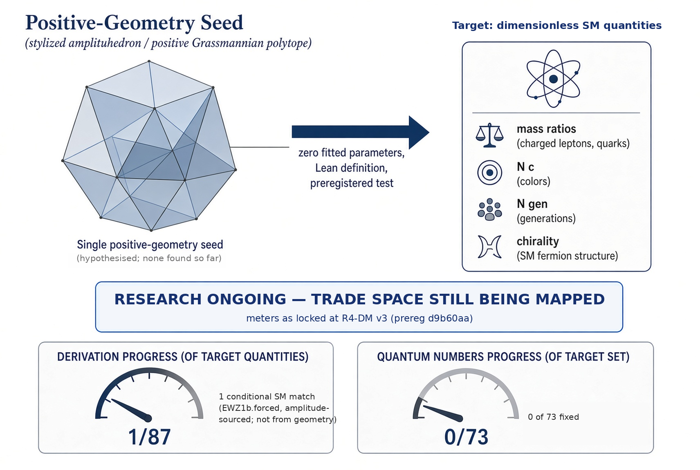
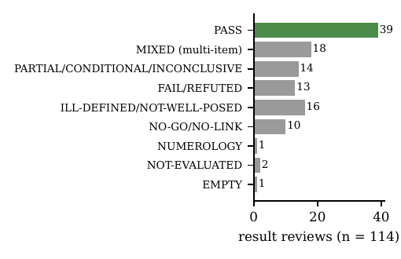
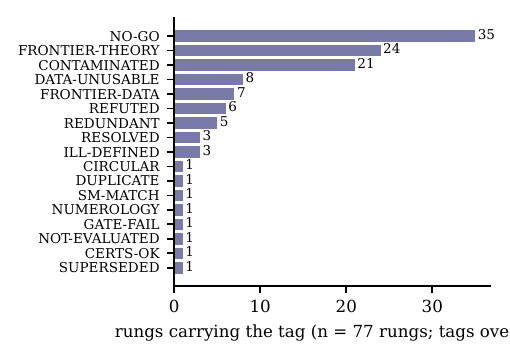
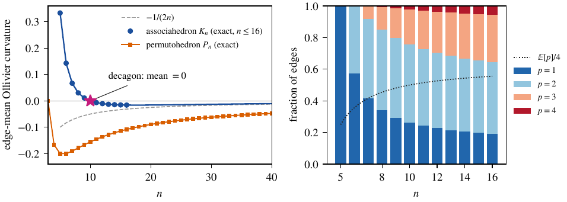

# UOPG: Positive Geometry, Emergent Spacetime, and the Standard Model

**A positive-geometry structure, checked in Lean, aimed at deriving the Standard Model with zero fitted parameters.** This is ongoing research, and every closed route stays on the record.

**The bar.** A result counts only if a dimensionless Standard-Model quantity (a mass ratio, a coupling ratio, a charge, the number of colours, the number of generations, or chirality) comes out of a positive-geometry object with zero fitted parameters, has a Lean definition, and passes a test that was preregistered before it ran.

<p align="center">
  
</p>

## The papers

Three papers are published on Zenodo. Each first link is the concept DOI, which always resolves to the latest version.

| | Paper | DOI |
|---|---|---|
| II | **Can positive geometry fix the Standard Model? Evidence from a Lean-verified agentic research programme.** The evidence: the Lean library, the mapped routes, the exclusion ledger, and what is still open. | [10.5281/zenodo.23932592](https://doi.org/10.5281/zenodo.23932592) (v8.3: [10.5281/zenodo.23932593](https://doi.org/10.5281/zenodo.23932593)) |
| I | **Governed human-agent research loops for mathematical physics.** The method: preregistration, locked checkers and formal proof as the operating system of AI-assisted discovery. | [10.5281/zenodo.23932674](https://doi.org/10.5281/zenodo.23932674) (v9.3: [10.5281/zenodo.23932675](https://doi.org/10.5281/zenodo.23932675)) |
| | **Exact Ollivier-Ricci curvature of the associahedron flip graph, and when it equals Forman curvature.** The exact curvature result, with the equality checked on 140,107 edges of 513 simple polytopes. | [10.5281/zenodo.23932724](https://doi.org/10.5281/zenodo.23932724) (v4.2: [10.5281/zenodo.23932725](https://doi.org/10.5281/zenodo.23932725)) |

Start with Paper II for what the programme has and has not established, and Paper I for how each result was gated.

## Where this stands

The work is in [`PositiveGeometryEmergentSpaceTime/`](PositiveGeometryEmergentSpaceTime/README.md): a Lean library, every preregistration, a locked checker per rung, every result review, and the exclusion ledger of closed routes. That folder's README carries the full status, the claim tags and the evidence index. The numbers below are from the axiom audit and the records in this repository.

| | Count |
|---|---|
| Lean library | **1378 theorems, 798 definitions**, over 140 modules `PROVED` |
| Axiom audit | **0 non-standard axioms, 0 `sorry`-dependent declarations**; only `propext`, `Classical.choice` and `Quot.sound` |
| Statement alignment | **75 modules** check that Lean says what the prose says: 409 cited declarations all exist and are axiom-clean, and of 125 judged paper claims **108 match exactly**, with the other 17 fixed by narrowing the prose |
| Sanity theorems | **969 further theorems** (32 modules) tying a definition to the object the paper names, or rejecting a planted wrong version |
| Preregistrations | **112**, each pushed before its run |
| Result reviews | **114**, kept whatever the outcome |
| Blocked routes | **77 tagged, 35 of them proved no-gos**, each with a reopen trigger |
| Exclusion ledger | **35 Lean-anchored no-go rows**, 30 more proposed |
| Derivation meter | **1 of 87** Standard-Model ledger items, and that one is conditional and amplitude-sourced, not from geometry |
| Quantum-number meter | **0 of 73** |

### What the record looks like

<p align="center">
  
</p>

**Results are kept when they fail.** Of 114 rung reviews, 39 pass and the rest are mixed, partial, ill-defined, refuted or no-go, and each one stays in the repository with the reason it closed. The two meters are the honest measure of the open target: one conditional Standard-Model item out of 87, and none of the 73 quantum numbers derived.

<p align="center">
  
</p>

## What is established

- **A Lean library of 1378 theorems and 798 definitions with no non-standard axioms and no unproved steps** `PROVED`. The audit is re-run on every export, and `AxiomsAll.lean` lists every declaration with the axioms it uses.
- **MR-1b, a blind match on a known amplitude.** Before any coupling data for the two excited states was opened, the Lovelace-Shapiro residues gave the ratios `5/16` and `49/240` `PROVED`. All four data comparisons pass, inside the preregistered bands `SIMULATED`. This checks an amplitude against blind data; it is not a derivation from geometry.
- **SURF-1′, a colour-sign no-go.** No `N ≥ 3` makes the one-loop colour factors sign-coherent, so surface-type colour sums cannot select the number of colours by a sign condition `PROVED`, and the result survives a convention re-check `SIMULATED`.
- **CASCADE-1b r2, a locked pass.** All 11 planted cases pass, `n = 4, 5` reproduce exactly, and at the blind `n = 6` the factorisation tests pass 90 of 90 and 36 of 36 while the off-family control passes 0 of 30, so the test discriminates `SIMULATED`. The held-out family follows from stage 3 by a translation of the mass offsets `PROVED`.
- **Exact curvature of polytope graphs.** On the associahedron flip graph the curvature of an edge is `(2 − p)/(n − 2)`, where `p` counts the quadrilateral sides that are diagonals: checked on all 26,175 edges for `n = 6` to `11` `SIMULATED` and proved on paper for all `n`. The mean curvature vanishes exactly at the decagon, which is proved in general and in Lean for the named instances `PROVED`.
- **The capped-Forman equality.** Equality holds on all 140,107 edges of 513 simple polytopes in dimensions 2 to 8, including 18,388 edges where the cap is active `SIMULATED`, and Lean proves the per-face optimisation and the six-sided criterion `PROVED`. Equality in general is a conjecture.
- **The Jordan identity on ℚ²⁷ and `dim Der = 52`** `PROVED`, so the exceptional structure the route needs is the one it claims.
- **35 proved no-gos**, each naming the Standard-Model line it closes and for which route, so a closed route is not silently reopened.

<p align="center">
  
</p>

*Edge-mean Ollivier curvature of the associahedron flip graph against `n`, and the edge mix by quadrilateral type. The mean is exactly zero at the decagon.*

## What is open

- **A zero-parameter Standard-Model quantity from a positive geometry.** This is the target, and it is not met: 1 of 87 on the derivation meter and 0 of 73 on quantum numbers.
- **CASCADE-2**, preregistered and not run, is the next rung against the open target.
- **The EW-Z1b tie**, the one conditional match, still has no Lean certificate; an independent derivation agrees with it on 200 of 200 points `SIMULATED`.
- **The capped-Forman equality in general** is unproved in every dimension, including 3.
- **CASCADE-1's locked FAIL** stands on the record; whether the audit voids it is unsettled.
- **The literature sweep is at abstract level.** A full-text pass would sharpen the novelty statements.

## How a result gets onto this page

Every test is a rung, and every rung passes the same gates: a question and a literature check, a preregistration pushed on its own before any code runs, a locked checker that refuses to run against an unpushed preregistration, planted cases that must pass and broken checkers that must be rejected, a live run with a run id, a seed and output hashes, a verdict by the locked rule with no hand adjudication, a Lean certificate with a re-run axiom audit, a review kept whatever the outcome, and finally a row in the exclusion ledger or the blocked-route registry. The full diagram and the gate definitions are in [`PositiveGeometryEmergentSpaceTime/README.md`](PositiveGeometryEmergentSpaceTime/README.md).

## Repository map

| Path | What it is |
|---|---|
| [`PositiveGeometryEmergentSpaceTime/`](PositiveGeometryEmergentSpaceTime/README.md) | The current programme: Lean library, preregistrations, reviews, runs, exclusion ledger. Start here. |
| [`lean/`](PositiveGeometryEmergentSpaceTime/lean) | The Lake package, with its own toolchain pin (`leanprover/lean4:v4.34.1`, Mathlib `d13f23b723b8`, Physlib `a4ef46125b32`). |
| [`prereg/`](PositiveGeometryEmergentSpaceTime/prereg) | Every preregistration, locked once its result exists. |
| [`reviews/`](PositiveGeometryEmergentSpaceTime/reviews) | Every result review, including the failures. |
| [`notes/EXCLUSION-LEDGER.md`](PositiveGeometryEmergentSpaceTime/notes/EXCLUSION-LEDGER.md) | The exclusion ledger: each closed route as a Lean-anchored row. |
| [`PROVENANCE.tsv`](PositiveGeometryEmergentSpaceTime/PROVENANCE.tsv) | Every exported file, with its source commit and hashes. |
| [`mvp0/`](mvp0/README.md), [`mvp1/`](mvp1/README.md), [`mvp2/`](mvp2/README.md), [`lemma/`](lemma/README.md) | The 2026 ladder on `Gr⁺(2,4)`. Frozen, and kept as the historical record below. |

## How to run

```bash
# The current programme: Lean build and the axiom audit
cd PositiveGeometryEmergentSpaceTime
./reproduce.sh

# The 2026 ladder on Gr+(2,4) (historical, independent Lake project)
cd ../mvp0/lean
lake exe cache get
lake build
lake exe uopg0 && lake exe uopg1 && lake exe uopg2 && lake exe rankone
```

## Licence and citation

MIT. `CITATION.cff` in the programme folder gives the citation form. Contact: [savanc@gmail.com](mailto:savanc@gmail.com).

---

# Historical record: the 2026 ladder on `Gr⁺(2,4)`

Everything below this line describes where the project started. It is kept as a record, and it is not the current status. The 2026 paper was calibrated so that the W-boson mass comes out at 80.4 GeV; that calibration was a fit, not a prediction, and no later result in this repository depends on it.

**Title as published:** UOPG: Emergent Spacetime and Particles from the Positive Grassmannian. A Geometric Model Calibrated to LHC W-Boson Mass.

**Abstract as published.** We present a geometric model in which the positive Grassmannian Gr+(k,n) serves as the single underlying structure. Positivity-preserving mutations generate curvature that projects to 3+1D Lorentzian spacetime. Wave interference on the emergent metric produces particles, entanglement, annihilation, and chiral asymmetry. The model is calibrated so the W-boson mass is exactly 80.4 GeV.

**Paper:** [10.5281/zenodo.19291218](https://doi.org/10.5281/zenodo.19291218), left as published.

## The ladder that was built on it

One object: the positive Grassmannian `Gr⁺(2,4)`. Spacetime is its Klein correspondence. A particle is not a theorem of this repository.


The first checked piece is [MVP-0](mvp0/README.md). It proves the Klein dictionary for `Gr⁺(2,4)`: the Plücker relation, the real `GL(2)` weight, one positive rational point, null separation, and four massless conserved edge momenta. The only experimental comparison is the PDG photon-mass bound, with no fitted scale. See [mvp0/DICTIONARY.md](mvp0/DICTIONARY.md).

The second checked piece is [MVP-1](mvp1/README.md). In the gauge that fixes columns 0 and 2, the positive chamber is the orthant, and the coefficient `1/(x y z w)` equals both `1` over the adjacent product and minus the cyclic Parke-Taylor coefficient. On the witness those numbers are `16/3` and `−16/3`. That is not a differential form, not a helicity, and not a cross section. See [mvp1/DICTIONARY.md](mvp1/DICTIONARY.md).

The third checked piece is [MVP-2](mvp2/README.md). The denominator vanishes exactly when one adjacent minor does. Cancelling one positive coordinate leaves `1` over the other three: `8/3` or `8` on the witness. `P13` stays positive on each face. One column shift at this witness sends `P23` from 1 to 0. That is not a mutation and not a cross section. See [mvp2/DICTIONARY.md](mvp2/DICTIONARY.md).

The rank-one lemma is [lemma/README.md](lemma/README.md). A singular `2 × 2` matrix is an outer product, and `u → t u`, `v → v / t` leaves it fixed. On the polygon the four edges match the factors in the shadow, including the rescaling at `t = 2`. That is not a helicity, and it does not turn the MVP-4 card green. MVP-3 stays blank. See [lemma/DICTIONARY.md](lemma/DICTIONARY.md).

The ladder on `Gr⁺(2,4)` is frozen. There is no further rung. The factorisation of a null edge is not unique: `t = 2` moves the edge-0 factor from `(−2, 0)` to `(−4, 0)` and leaves the momentum fixed. The corollary that every function of that momentum is unchanged does not rule out a helicity. MVP-4 stays a contract. The map of what is proved and what is only a contract is [docs/ROADMAP.md](docs/ROADMAP.md).

## Historical files

- **MVP-0 (proved)**: [mvp0/README.md](mvp0/README.md)
- **MVP-1 (proved coefficient, not an amplitude)**: [mvp1/README.md](mvp1/README.md)
- **MVP-2 (proved face residue, not a cross section)**: [mvp2/README.md](mvp2/README.md)
- **Rank-one lemma (not a helicity, MVP-4 stays a contract)**: [lemma/README.md](lemma/README.md)
- **Lean 4 formalisation (draft concept)**: [UOPGv2.lean](UOPGv2.lean)
- **Draft sketches from March and April 2026**: [`UOPG.lean`](UOPG.lean) and [`UOPGv2.lean`](UOPGv2.lean). These are not kernel-checked proofs and do not form a Lake project, and `m_W = 80.4 GeV` is not a theorem of this repository.
- **Numerical notebook**: [UOPG.ipynb](UOPG.ipynb), an executable SymPy notebook (harmonic emergence, emergent metric, mutations, wave interference, Monte-Carlo calibration to 80.4 GeV)
- **Slide deck**: [UOPG v2 slide deck](Unified_Positive_Geometry.pdf)
